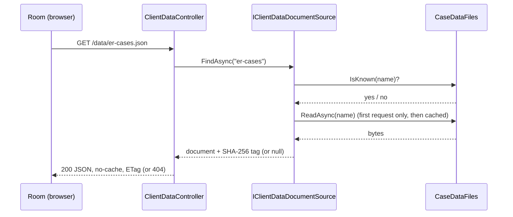
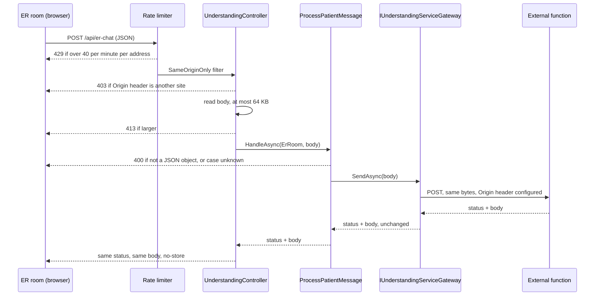
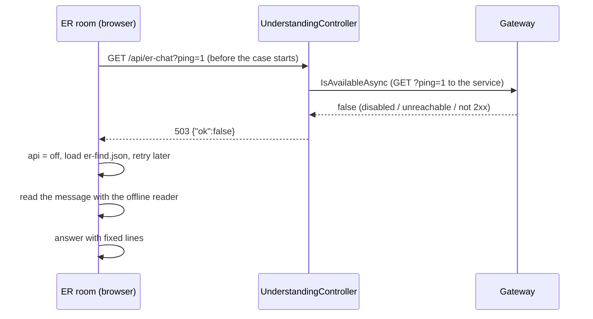
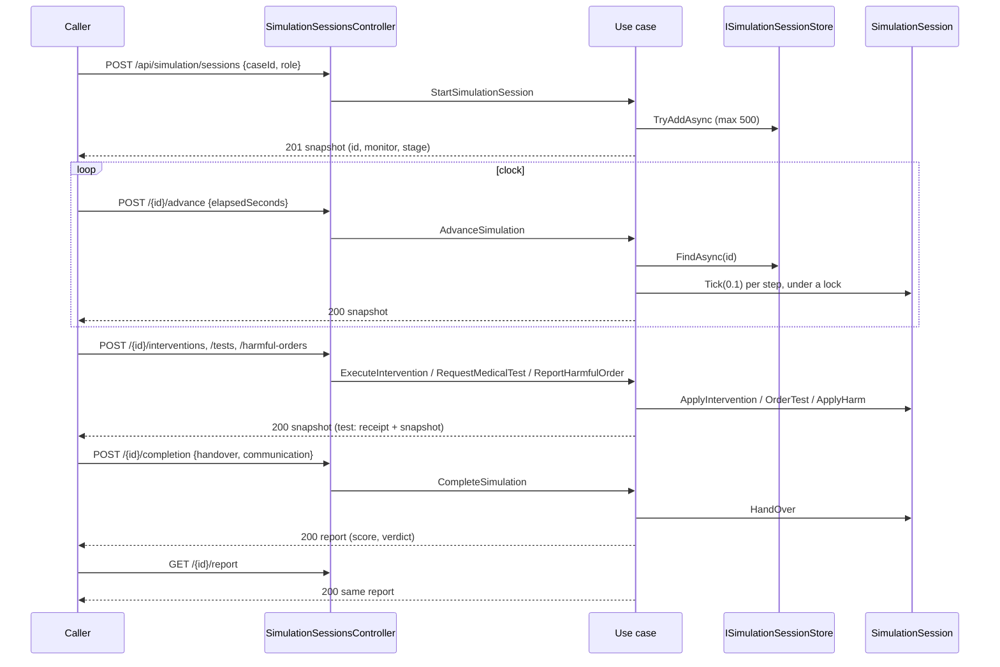

# Workflows

The journeys a person takes through Nabd 7, and the flows the system runs underneath them. The demo script for the
committee is [demo-script.ar.md](demo-script.ar.md); the walks that check these journeys are in `tools/qa`.

## User journeys

### 1. A visitor on the landing page

The public landing (sections, the room's screenshot, specialties, method, institutions). «تسجيل الدخول» and «إنشاء
حساب» open the sign-in screen at `/login` and `/register`; a signed-in page asked for while signed out opens it too.

### 2. Sign-in and registration

- **Sign-in by e-mail.** The e-mail decides the account (`app/020-access.js`): Nabd's administration and the
  university staff and students on a roster enter directly; a university's domain off its roster is refused with
  its name; an e-mail with no account goes to registration with the e-mail filled in (D-59).
- **Registration** is one step: name, e-mail, the track (must be chosen; it decides the role in the room for good,
  D-57) and the year (D-58).
- **Demo buttons** open the three consoles.

### 3. An independent trainee

Home → «ابدأ أول حالة» (or the ER card) → the room's briefing, in the role of his track → the session → the handover
and the report → the report is saved with the account → the home's facts, «تقاريري», the profile's skills and repeated
errors, and the coach all read it. The coach names the gaps, runs the guided drill and suggests the real case next.
«بياناتي» in the profile changes the name, track, year and photo.

### 4. A university student

The same, plus her section's assignments on the home (an assignment opens its case in the room) and, after the
supervisor publishes, the approved mark, his rating and his note in her report.

### 5. A supervisor

«بوابة المشرف» → assign a case to a section → «النتائج والاعتماد»: every session, real ones marked → the file of a
session (what the student did, the handover as written, the timeline, the reflection) → override the mark with a
written reason or waive a critical error with one → rate → approve and publish → the student sees it.

### 6. A university administrator and Nabd's administration

The university: courses and sections, staff, the student roster by e-mail, which of Nabd's cases are open, pass marks
per year, the supervisors' permissions. Nabd: institutions, users, subscriptions, the case library and its review,
sources, scoring rules, audit, settings (the realism switch, demo data on the coach page, demo reset).

## System flows

All paths below are in `src/Nabd.Web/Program.cs` and the controllers named. In the pipeline order of
`Program.cs`: exception handler, security headers, static files, rate limiter, controllers.

### Flow 1. Loading the page

`GET /` (or `/login`, `/register`) returns the page: the Razor layout and its partial views, with image paths from
`images.json`. The browser then asks for the stylesheets, the images and nine script bundles, in this order:
`script.js`, `motion.js`, `terms.js`, `ui.js`, `er.js`, `landing.js`, `admin.js`, `app.js`, `er-plus.js`.

- `ClientScriptsController.Get` (`GET /js/{fileName}`) asks `ClientBundleProvider.Find`, which joins the fragments of
  each bundle by plain concatenation (optional `open` and `close` pieces, line feeds) and computes a SHA-256 entity
  tag. An unknown name gives 404; source fragments cannot be requested. `Cache-Control: no-cache` with the tag.
- Stylesheets and images are static files from `wwwroot`.
- The head links a font stylesheet on a third-party host (Google Fonts, the shell's base font); the Arabic interface
  font is self-hosted.

### Flow 2. The room loading its data

The room fetches `data/er-cases.json` when it opens, and the two small offline models (`data/er-act.json`,
`data/er-find.json`) for flow 4. The consoles and the student's academic part read `er-cases` for the cases' names.

Three names are known (`er-cases`, `er-act`, `er-find`); any other returns 404 without touching the disk.
`CaseDataFiles.ReadAsync` is the only code that opens the files, from `CaseData/Files` or `CaseData:RootPath`.
`er-cases.json` still reaches the browser, so a trainee could read diagnoses and expected steps in it
([architecture.md](architecture.md), "Data exposure").

### Flow 3. A turn in the ER room with the understanding service on

The service is on when `UnderstandingServices:ErRoom:Enabled` is true (the default outside Development), an
endpoint is configured and it uses HTTPS or is a loopback address.

Order of the checks, from `Program.cs`, `UnderstandingController` and `ProcessPatientMessage`:

1. The rate limiter (`app.UseRateLimiter()`) runs before the controller. Policy `understanding`: fixed window of
   one minute, 40 requests per caller address, no queue (`RateLimits:UnderstandingPerMinute`). Over the limit: 429.
2. `[SameOriginOnly]`: if an `Origin` header is present and is not this host, the answer is 403 `{"error":"origin"}`.
   No header (a same-site GET, a server caller) passes. This is not authentication.
3. The controller reads the body in 8 KB chunks. More than 64 KB (by `Content-Length` or while reading): 413.
4. `ProcessPatientMessage` parses the body. Not JSON, or not an object: 400 `{"error":"bad request"}`. For the ER
   room, the `case` property must name a case that `IClinicalCaseRepository` knows; otherwise 400 `{"error":"case"}`.
5. `HttpUnderstandingServiceGateway.SendAsync` posts the bytes to the configured endpoint with an `Origin` header
   (the configured one, or the endpoint's own origin), a timeout (default 20 s, limited to 1 to 60 s) and a cap of
   256 KB on the answer. Disabled, not configured, not HTTPS, unreachable, slow or oversized: the answer is 503.
6. Status and body return **unchanged**, with `Cache-Control: no-store`. A status of 400 or more is logged as a
   warning (service name and status only, not the body).

What the room does with the answer (client fragment `er/100-server-client.js`):

| Answer | What the room does |
|---|---|
| 200 with a JSON body | Marks the service "on", resets its failure counter, uses the fields it needs (`read`, `to`, `reply`, `held`, `voiceFailed`, `unplaced`). If the room had announced the outage, it says once that the connection is back |
| 403, 404, 405, 429 or 503 | Goes offline at once (flow 4) |
| Any other status (400, 413, 500, 502) or a network error or a timeout | Counts one failure; at the third consecutive failure it goes offline. This one turn gets no service answer and the room uses its own reading |
| 200 with a body that is not JSON | Counts one failure, like a network error (the parse fails inside the same `try`) |

The room never reads the error text; it reads only the status. Client time limits: 15 s for a turn, 9 s for a
spoken line, 12 s for the handover grade. The reading rules, routing rules, prompts and model key live in the
external function, which is outside this repository.

Status of the proof: tested against a fake transport only (`Web/UnderstandingEndpointTests`,
`Infrastructure/HttpUnderstandingServiceGatewayTests`). No request reached the real function.

### Flow 4. The same room offline

Offline means: the service is off in settings, unreachable, answering with a "go offline" status, or the caller
is over the rate limit.

- When the room opens, it sends `GET /api/er-chat?ping=1&_=<time>` with a 4.5 s limit. `UnderstandingController.ErPing`
  answers 200 `{"ok":true}` or 503 `{"ok":false}`. A request without the `ping` parameter gets 405. No model is
  called by a ping. The ping is subject to the same rate limit and the same-origin filter.
- In Development the ER service is off, so the ping answers 503 and the room starts offline. This is the normal
  local state.
- On a failed ping the client sets the service to "off", retries later (audit part 31 says after 15 s) and loads
  the small finding model `data/er-find.json`. `data/er-act.json` is loaded when the room opens.
- Once offline, the room shows one system line saying the service is not available and that the room runs in a
  simplified mode and may not understand every sentence. It keeps knocking once a minute: a retry is allowed
  60 s after the last failure and is then limited to 4 s. A page opened from `file:` stays offline.
- Offline, the browser reads the message itself: the act model (`readAct`), the finding model (`readFinding`),
  the dose and order readers (`localRead`) and fixed Arabic lines for the patient, the companion, the nurse and
  the supervisor (fragments `110` to `220` of the ER bundle). The companion's unprompted line is skipped when
  the service is off.
- Quality of the offline mode: an earlier user test of the room, recorded outside this repository, found
  it weaker than the online mode. The numbers are not in the sources read for this document; not determined.
- A fixed 40-message conversation in each case, offline and with a stub service, is pinned by the conversation
  golden master ([testing-strategy.md](testing-strategy.md)).

### Flow 5. A server-side session through the API

**The browser room does not use this path.** The API answers 404 unless `Simulation:ServerSessionsApi:Enabled`
is true. It is true in Development and in tests, and false otherwise. It exists to prove the server-side model,
and it is the path the next phase would move the room onto.

All routes sit under `/api/simulation/sessions`, with `[SameOriginOnly]` and the `simulation` rate limit (240 per
minute per address). Every action first checks the switch (`Guarded()`), then calls one use case.

| Call | Route | Use case | Domain member reached |
|---|---|---|---|
| Start | `POST /api/simulation/sessions` | `StartSimulationSession` | `SimulationSession.Start` (case from `IClinicalCaseRepository`, catalog, role) |
| Let time pass | `POST /{id}/advance` | `AdvanceSimulation` | `SimulationSession.Tick(0.1)` repeated |
| Intervention | `POST /{id}/interventions` | `ExecuteIntervention` | `Case.CareFor`, `ApplyIntervention` |
| Harmful order | `POST /{id}/harmful-orders` | `ReportHarmfulOrder` | `ApplyHarm` |
| Test | `POST /{id}/tests` | `RequestMedicalTest` | `OrderTest` |
| Complete | `POST /{id}/completion` | `CompleteSimulation` | `RecordHistory`, `RecordExamination`, `HandOver`, then `SessionReport.Of` (uses `SessionScorer`) |
| Report | `GET /{id}/report` | `GenerateSessionReport` | `SessionReport.Of` |

Details checked in `SimulationUseCases.cs`:

- **Start**: needs a case id (empty gives 400); an unknown case gives 404; a full store gives 503. The id is a
  GUID, sent in "N" format (32 hex characters).
- **Advance**: `ElapsedSeconds` must be between 0 and 120 (otherwise 400). The use case takes
  `round(elapsed / 0.1)` steps of 0.1 s and stops when the session is over.
- **Intervention**: the session must be open (409 if ended); the action must exist in the catalog (400); the
  amount cannot be negative. The dose text is cut to 60 characters. The reason grade is fixed to "good" here.
- **Harmful order**: the harm profile is supplied by the caller ("as the client judged it"). This input is
  transitional, because order safety is still in the room (decision 0007).
- **Test**: the test id must exist and the reason grade must be `good`, `weak` or `ungraded`. The answer carries
  the test id, the minute it was ordered and the snapshot. It does not carry the indication of the test.
- **Complete**: only the doctor role is scored on the server (a nurse session gets 400). The destination must be
  one of `icu`, `hdu`, `cath`, `ward`, `home`. A second completion gives 409. While the patient is alive a
  handover is required. After an arrest, any handover sent is ignored. The handover is taken as already graded
  (transitional).
- **Report**: 409 until the session is completed.

What a response contains: the monitor, the cuff reading, the stage, and what was done. What it does **not**
contain: the patient's risk number, the indication of a test, and the scoring rules before the report. A test
asserts the absence of these fields (`Web/SimulationSessionsApiTests`).

Limits: sessions live in memory (`InMemorySimulationSessionStore`), at most 500 and dropped after 120 idle
minutes; they do not survive a restart. A session id is the only protection, because there is no authentication.

## The clock of a session

Time in a session is simulated. One real second is one simulated second (`Pace = 1`); the unit used in the
model is the simulated minute.

### The room's clock (browser)

`er/050-risk-tick.js` runs `tick(now)` once per animation frame while the case is open:

1. `dt = clamp((now - last) / 1000, 0, 2)` seconds. A slow frame never moves time by more than 2 s.
2. `step = dt * PACE / 60` minutes. The simulated minute counter and the risk advance by `rate * step`; the
   risk is clamped between the floor (20) and 100.
3. The risk is logged every 0.25 minute. The monitor is painted every 0.12 minute.
4. Delayed jobs that are due run (`E.jobs`).
5. `stageCheck()` follows the risk. In the nurse role `nurseTick()` also runs.

Typed orders and answers arrive between frames, at one of two points of a tick (the golden-master traces record
both points).

### The domain clock (server)

`SimulationSession.Tick(elapsedSeconds)` does the same work in three named parts, so that an input can be placed
exactly between them as the room's code allowed. It returns at once if the session is over.

| Part | Method | What it does |
|---|---|---|
| 1 | `BeginTick` | Caps the step at 2 s. Moves the minute counter and the risk (clamped between 20 and 100). Logs the risk every 0.25 minute. Refreshes the monitor every 0.12 minute (which may take a cuff reading). Runs the delayed effects that are due |
| 2 | `ReassessStage` | The stage follows the risk. A worsening stage is announced at once. An improvement is announced only after the patient had reached the urgent stage or worse |
| 3 | `EndTick` | At a risk of 100 the patient arrests and the session closes |

The risk rate is net: the case's own rate, minus the slowing of treatments that have started, with a hold in
some cases (until the cause is treated, the rate cannot fall below zero while the risk is at or below the hold
level, so supportive care holds the patient but does not turn the case round).

### The cuff cycle

The blood pressure is not continuous. `Cuff` holds the last reading.

| Rule | Value |
|---|---|
| First reading | Taken when the session starts |
| Normal cycle | Due every 2 minutes (`CuffEveryMinutes`) |
| Cycle once the stage is urgent or worse | Due every 1 minute (`CuffWhenSickMinutes`) |
| Taken at once, outside the cycle | When the stage worsens to urgent or worse; when a worsening stage's cue names measured signs; when the stage improves from urgent or worse; when a repeat pressure is ordered; after a harm takes effect; after adrenaline takes effect in anaphylaxis; once a treatment that moves the vital signs has had time to work (its ramp plus 0.1 minute; treatments given close together share one reading; none is taken if the patient is critical or the risk has risen by more than 2 since the order) |
| When the cycle is checked | Only at the monitor refresh (every 0.12 minute), so a reading can be up to that late |

### Delayed effects

Effects that happen later are queued with `After(minutes, action)` and run in part 1 of the first tick at or after
their time.

| Effect | Delay | Result |
|---|---|---|
| Harmful order takes effect | 0.3 minute | The risk rises by the harm's value (default 12, or 18 for an allergic reaction unless the profile says otherwise); an anaphylaxis may start |
| Adrenaline given during anaphylaxis | 0.15 minute | The risk falls by 18; a cuff reading is taken |
| Shock delivered during ventricular tachycardia | 0.1 minute | The risk is set to the critical level minus 5, the stage to urgent, the rhythm is restored |
| Treatment onset | Case data (`OnsetMinutes`) | The risk slowing of that treatment starts to count |
| Vital-sign effect of a treatment | Starts 0.03 minute after the order and ramps over the treatment's ramp time (default 0.2 minute) | The monitor values move |

All of these are pinned bit for bit by the golden masters for the doctor role and the nurse role dynamics
(`GoldenMasters/ErClinicalTraceTests`).

## Developer workflows

### Build, test and run

`dotnet build`, `dotnet test`, `dotnet run --project src/Nabd.Web --launch-profile http` ([setup.md](setup.md)).

### Check a change in the browser

With the site running: `node tools/qa/seats.mjs qa-out 1440 900`, then `390 844`, and `tools/qa/rules-of-entry.mjs`.
A clean run ends with `errors: []` and no ✗ line.

### Approve a designed region after an intended change

`node tools/approve-regions.mjs` with the site running; review the diff of `tests/Nabd.Tests/LandingBaseline/*.html`;
commit it with the change.

### Change the approved room

The owner's decision. Show the change first; then update the two fingerprints in
`SiteAssetsTests.The_approved_emergency_room_is_unchanged`. A change to a clinical rule also fails the golden masters
on purpose: record new traces only for a reviewed clinical change.

### Add a use case

One sealed class with one `HandleAsync` in `Nabd.Application`, a port in `Abstractions/` if it needs the outside
world, an adapter in `Nabd.Infrastructure`, a thin action in a controller, and tests at each layer.

## Failure handling

Failures never show a stack trace to the browser. `app.UseExceptionHandler()` with `AddProblemDetails()` turns an
unexpected exception into a short problem document; details go to the log.

| What fails | What the user sees | Where it is handled |
|---|---|---|
| The understanding service is unreachable, slow, disabled or not configured | The relay answers 503. The ER room announces once that the connection is not available, then runs offline with its own reader and fixed lines. It tries again about once a minute | `HttpUnderstandingServiceGateway` (maps every transport failure to 503); client `goOff()` in `er/100-server-client.js` |
| The caller is over the rate limit (more than 40 requests a minute to the room endpoints) | 429. The room goes offline at once, for about a minute | Rate limiter registered in `RateLimitPolicies.AddNabdRateLimits`; client status list (403, 404, 405, 429, 503) |
| The room's availability check (`GET /api/er-chat?ping=1`) fails | The room starts offline | `UnderstandingController.ErPing` (503 `{"ok":false}`); client `ping()` |
| A request from another site | 403 `{"error":"origin"}`. The room treats 403 as "go offline". A normal visitor of this site does not see this | `SameOriginOnlyAttribute` |
| Unknown case in a room request | 400 `{"error":"case"}`. The room counts one failure; three in a row put it offline | `ProcessPatientMessage` |
| Body is not a JSON object | 400 `{"error":"bad request"}`. Same client handling | `ProcessPatientMessage` |
| Oversized request (over 64 KB) | 413 `{"error":"too large"}`. Same client handling as other non-listed statuses. The browser room does not send such a body in normal use | `UnderstandingController.ReadBodyAsync`, `ProcessPatientMessage` |
| Unknown script name or data name | 404. The page or the room that asked fails to load that item | `ClientScriptsController`, `ClientDataController` |
| A data file is missing on disk | An exception in the data source, answered as a 500 problem document. Whether the room shows anything useful is not determined | `CaseDataFiles.ReadAsync`, exception handler |
| Session API switched off | 404 for every route | `SimulationSessionsController.Guarded` |
| Unknown or malformed session id (session API) | 404 problem document "Unknown session." A session dropped after 120 idle minutes reads the same | `SessionStoreExtensions.FindSessionAsync`, `InMemorySimulationSessionStore.FindAsync` |
| Unknown case when starting a session | 404 problem document "Unknown case." | `StartSimulationSession` |
| Session already ended (intervention, harmful order or test) | 409 problem document "The session has ended." | `ExecuteIntervention`, `ReportHarmfulOrder`, `RequestMedicalTest` |
| Completing twice, or reading a report before completion | 409 problem document | `CompleteSimulation`, `GenerateSessionReport` |
| Invalid values (negative amount, elapsed time outside 0 to 120 s, unknown action, test, destination or reason grade) | 400 problem document | The use case that owns the input |
| Malformed JSON body on a session route | 400, with no stack trace in the body | `[ApiController]` binding; test `Wrong_requests_get_a_problem_document_and_never_a_stack_trace` |
| Session store full (500 sessions) | 503 problem document "Too many sessions are running." | `StartSimulationSession`, `InMemorySimulationSessionStore.TryAddAsync` |
| Session API over its rate limit (240 a minute) | 429. No browser client uses this API | Rate limiter |
| An unhandled exception | A short problem document (status 500) with no stack trace; the details are logged. A test of this exact case was not found in the files read for this document: not determined | `Program.cs` (`UseExceptionHandler`) |

Browser-side failures (storage blocked, a malformed saved account) are handled by the store's fallbacks
(`script/100-local-storage-store.js`, `shared/010-store.js`). The case in progress is lost on reload.
